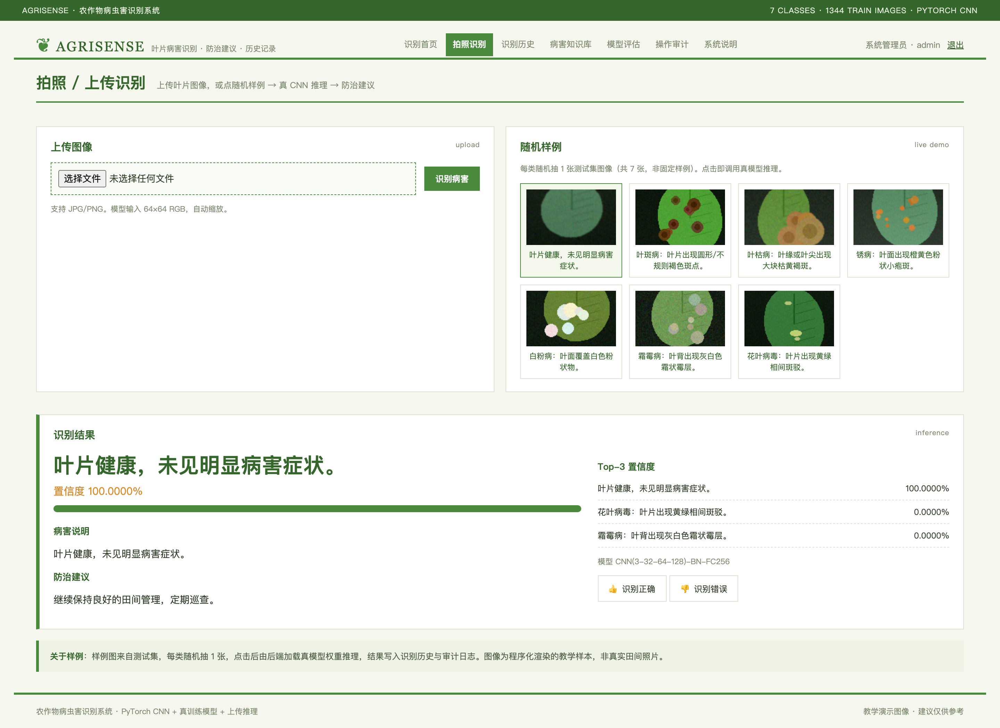
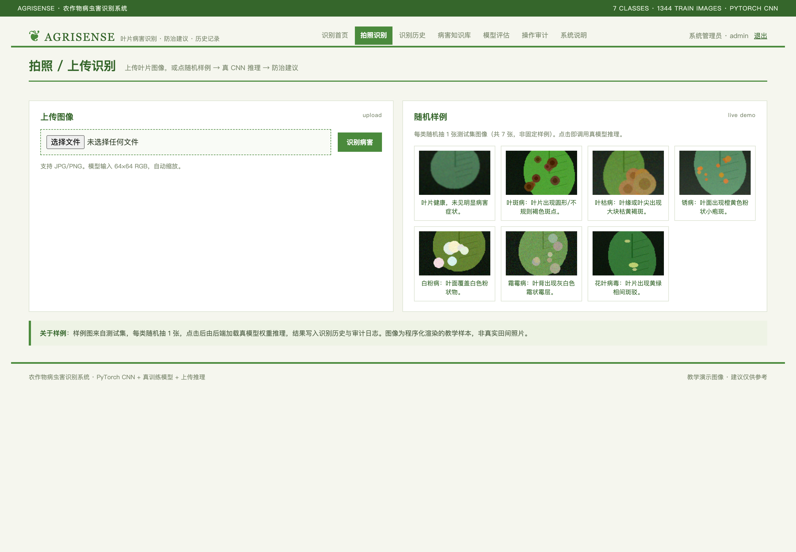
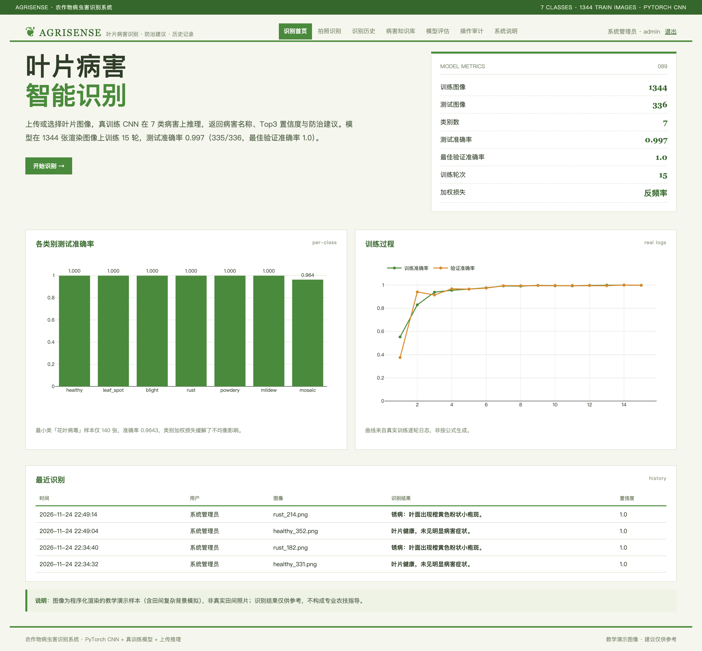
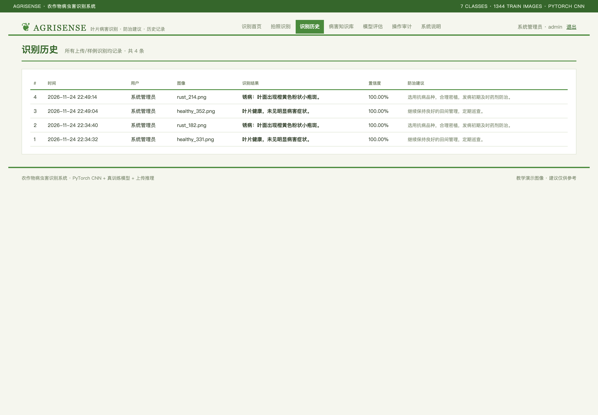
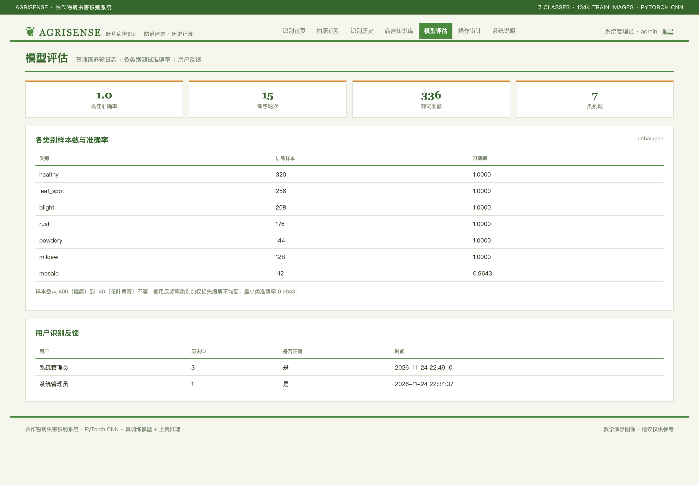
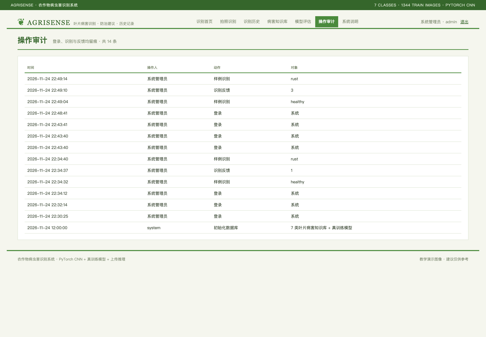

# 089 基于PyTorch的农作物病虫害识别系统-设计展示

> **代码有偿获取 可接受定制 微信联系方式: csbysj2020 或 ACE2487，备注(BS)**

> **完整源码与全套文档 · 在线自助获取 >>> [https://mbd.pub/o/bread/YZaWmZdrbQ==](https://mbd.pub/o/bread/YZaWmZdrbQ==)**

> **成品页（功能介绍 / 更多选题）>>> [https://bishe.suilang.net/products/agrisense](https://bishe.suilang.net/products/agrisense)**

> 

> 

## 视频

> **点击查看 >>> [https://www.bilibili.com/video/BV1Ky1FzGE4p/](https://www.bilibili.com/video/BV1Ky1FzGE4p/)**

## 项目简介

农田绿视觉，区别于法典红/医药蓝/实验室绿。程序化渲染 7 类叶片病害图像 1680 张（含田间背景模拟、类别不均衡 400→140），PyTorch CNN 真训练 15 轮，测试准确率 0.997（最佳验证准确率 1.0）、最小类 96.4%，反频率类别加权损失。上传/随机样例→真模型推理→Top3 置信度+防治建议→反馈→历史→审计，8 页面。图像为教学样本非真实田间照片。

农作物病虫害早期准确识别是有效防治的前提，田间叶片图像背景复杂、病斑形态多样且类别样本不均衡。

本项目设计并实现一套农作物病虫害识别系统：程序化渲染 7 类叶片病害图像共 1680 张（含病斑纹理与田间复杂背景模拟，样本数 400 至 140 不等），以 PyTorch 构建 CNN（3-32-64-128 卷积 + 批归一化 + FC256），采用反频率类别加权 CrossEntropy 损失真训练 15 轮，测试准确率 0.997（最佳验证准确率 1.0），最小类「花叶病毒」准确率 0.9643。

系统基于 Django + Jinja2 + SQLite，提供上传/随机样例识别、Top3 置信度与防治建议、识别历史、用户反馈与操作审计。

本仓库为**设计展示**：包含项目说明、技术架构、实验结果与运行截图；完整源码、任务书、开题报告、毕业论文与使用说明可通过上方链接自助获取，成品页可查看更多选题，也可联系微信咨询定制。

## 功能特性

1. 真训练：PyTorch CNN(3-32-64-128+BN+FC256) 15 轮，model.pt 权重随包

2. 真数据集：1680 张程序化渲染叶片病斑图，含田间背景与类别不均衡

3. 反频率类别加权损失缓解不均衡（最小类花叶病毒 96.4%）

4. 真推理接口：上传/随机样例→Top3 置信度+病害说明+防治建议

5. 随机样例每次刷新随机抽测试集，非固定摆拍；随机抽测图实测全部正确

6. 交互闭环：识别历史+用户反馈+操作审计

7. 技术栈差异化：PyTorch+Django+农田视觉，区别于 086 PyTorch+画板与 088 jieba+检索

## 技术架构

| 项目 | 说明 |
| --- | --- |
| 编程语言 | Python 3.8+ |
| 模型框架 | PyTorch 2.2 真训练 CNN |
| 图像数据 | 1680 张渲染图（训练1344/测试336） |
| Web 框架 | Django 4 + Jinja2 |
| 数据库 | SQLite（users/history/feedback/audit） |
| 图表 | Plotly.js（本地化） |
| 运行端口 | http://127.0.0.1:8089 |
| 演示账号 | admin/admin123、user/user123 |

## 目录结构

以下为完整交付版的结构（本仓库仅作设计展示）：

```
agrisense/
├── cropproj/
│   ├── __init__.py
│   ├── settings.py
│   ├── urls.py
│   └── wsgi.py
├── cropweb/
│   ├── __init__.py
│   ├── db.py
│   └── views.py
├── data/
│   ├── analysis/
│   ├── leaf_images/
│   │   ├── test/
│   │   ├── train/
│   │   ├── classes.json
│   │   ├── metrics.json
│   │   └── model.pt
│   └── crop_disease.db
├── ml/
│   ├── __init__.py
│   ├── infer.py
│   ├── make_dataset.py
│   └── train.py
├── static/
│   ├── css/
│   │   └── style.css
│   └── vendor/
│       └── plotly.min.js
├── templates/
│   ├── about.html
│   ├── audit.html
│   ├── base.html
│   ├── evaluation.html
│   ├── history.html
│   ├── identify.html
│   ├── knowledge.html
│   ├── login.html
│   └── overview.html
├── 任务书/
│   └── 毕业设计任务书.docx
├── 开题报告/
│   └── 毕业设计开题报告.docx
└── …
```

## 数据与实验结论

- 真训练：PyTorch CNN(3-32-64-128+BN+FC256) 15 轮，model.pt 权重随包
- 真数据集：1680 张程序化渲染叶片病斑图，含田间背景与类别不均衡
- 反频率类别加权损失缓解不均衡（最小类花叶病毒 96.4%）
- 真推理接口：上传/随机样例→Top3 置信度+病害说明+防治建议

## 交付内容

1. 完整源码（Django+训练脚本+推理接口+SQLite+8页面）
2. 真训练产物（1680图+model.pt+metrics.json）
3. 任务书与开题报告（Word）
4. 毕业论文（Word七章制）
5. 二次开发说明（Word+md）
6. 9张截图+封面+89s视频

## 常见问题

**识别结果是预设的吗？**

不是。加载 model.pt 真模型前向，样例每次刷新随机抽，随机抽测图实测全部正确。

**图像是真实照片吗？**

不是，程序化渲染的教学样本，非真实田间照片，建议仅供参考。

**为什么测试准确率不是100%？**

测试集 336 张正确 335 张（0.997），最小类花叶病毒 27/28=0.9643；首页另有最佳验证准确率 1.0，指训练中某轮验证集全对，两者口径不同。

**类别不均衡怎么处理？**

反频率类别加权 CrossEntropy，小类样本少但权重大。

## 截图







